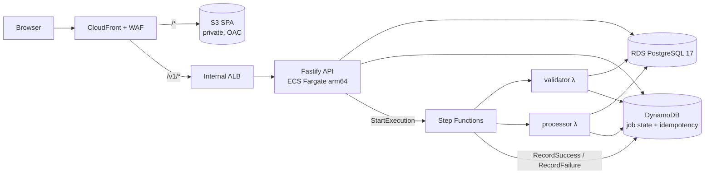

# AWS Modernization Starter

A reference implementation of a modernized AWS workload, built as a pnpm TypeScript monorepo and
delivered through GitLab CI. It contains a small sample application, the AWS CDK v2 infrastructure
to run it, policy-as-code checks for that infrastructure, and a CI pipeline that tests the
infrastructure against an AWS emulator (MiniStack) without an AWS account.

Use it to evaluate patterns, or as a starting point you adapt to your own organization.

## What it is

- **Sample workload.** A React + Vite single-page application, a Fastify API on ECS Fargate, and a
  Step Functions workflow with Lambda handlers; PostgreSQL (RDS) is the system of record and DynamoDB
  holds workflow and idempotency state. OIDC/JWT authentication with owner-scoped access,
  least-privilege database identities with verified TLS, and a claim-check workflow input that
  carries no document content.
- **Infrastructure as code.** AWS CDK v2 stages for `dev`, `staging` and `prod` that **import** a
  landing zone (VPC, KMS keys, certificates, permissions boundary) instead of creating it, an opt-in
  self-contained sandbox profile, and an ephemeral integration mini-stack. The deployment region is
  configurable (default `ap-southeast-1`).
- **Policy-as-code.** A cdk-nag rule pack and CloudFormation Guard rules that run at synth time and
  in CI, with expiring, reviewed exceptions; an offline cost-impact and destructive-change gate.
- **GitLab CI.** A dependency-aware pipeline (only the affected components are tested), security
  scanning, rootless container builds with SBOM and provenance, a mandatory gate, and two jobs that
  deploy the integration mini-stack to the **MiniStack** AWS emulator, reconcile every resource and
  run the workflow tests. It needs only one generic runner; signing, gate integrity,
  AI review and AWS jobs are explicit opt-ins.

## What it is not

- **Not a certified or approved control set.** The policy rules are a proposed baseline. They have
  not been approved by any organization, auditor or regulator; adapt and approve them yourself.
- **Not deployed for you.** Nothing in this repository creates AWS resources unless an operator runs
  a deployment explicitly. The account, network, key and certificate values in
  `infra/environments/` are placeholders.
- **Not proof of production readiness.** The governed `dev`/`staging`/`prod` profiles have never been
  deployed. The reference was validated once, in a disposable personal sandbox account with
  synthetic data (the run evidence is not published); that shows functional behaviour on ordinary
  AWS, not compliance with any landing zone. Emulator and local runs are not AWS evidence. See [docs/limitations.md](docs/limitations.md).

## Architecture



A user submits a document-analysis job in the SPA. The API authenticates the caller, stores the job
in PostgreSQL and starts a Step Functions execution with only the job reference. The Lambda handlers
load the document from PostgreSQL, apply the business rules and record the result in DynamoDB; the
SPA polls for it. Details: [docs/architecture.md](docs/architecture.md).

| Path                                  | Contents                                                                                         |
| ------------------------------------- | ------------------------------------------------------------------------------------------------ |
| `apps/web`, `apps/api`                | React 19 + Vite SPA; Fastify 5 API (OpenAPI, SQL migrations, graceful shutdown)                  |
| `functions/*`, `workflows/processing` | Lambda handlers; the workflow spec shared by the CDK definition and the local simulator          |
| `packages/*`                          | contracts (zod + OpenAPI 3.1), domain logic, job state, database, observability, config, testing |
| `infra`                               | AWS CDK v2 constructs, stacks, stages, environment configs, integration mini-stack               |
| `policies`                            | cdk-nag rule pack, CloudFormation Guard rules, fixtures, exception registers                     |
| `tools/*`                             | CI impact analysis and helpers, FinOps gate, drift detection, AWS preflight, test IdP            |
| `tests/*`                             | smoke, integration, security, browser E2E, AWS integration (emulator and opt-in real AWS)        |
| `.gitlab-ci.yml`, `.gitlab/ci`        | GitLab CI pipeline (per-component rules generated from `components.yaml`)                        |
| `local/compose`                       | local application stack on rootless Podman                                                       |

## Quick start

The tiers build on each other; stop at the one you need. Full instructions:
[docs/getting-started.md](docs/getting-started.md).

**Tier 0 — offline unit tests (no containers, no AWS).** macOS or Linux, Node.js 24 (`pnpm install`
refuses another major) and pnpm 12 — no global install needed: use `npm exec --yes pnpm@12.11.2 --`
in place of `pnpm`:

```bash
pnpm install --frozen-lockfile
pnpm build && pnpm typecheck && pnpm test   # build first: packages resolve each other's dist/
pnpm --filter @starter/infra synth          # offline CDK synth of every stage (cdk-nag runs inside)
```

**Tier 1 — local stack (rootless Podman on macOS or Linux).** PostgreSQL, DynamoDB Local, the API, the
web tier and a TEST ONLY identity provider on your machine (`scripts/podman/rootless-socket.sh`
provides the rootless socket on both platforms), plus the integration, security and browser suites. The
workflow runs as an in-process simulation, not Step Functions. See
[docs/development.md](docs/development.md) and [docs/testing.md](docs/testing.md).

**Tier 2 — GitLab CI.** Push to a GitLab project with one generic Docker-executor runner; no CI/CD
variables are required (verified on a self-managed GitLab CE; GitLab.com hosted runners are expected
to work but untested). The pipeline includes the MiniStack emulator jobs. Every merge-request
pipeline ends with `approval:human`, a manual job someone other than the head-commit author runs;
set `REQUIRE_HUMAN_APPROVAL=false` to remove it. See
[docs/ci-cd.md](docs/ci-cd.md) §11 and [docs/ministack.md](docs/ministack.md).

**Tier 3 — optional AWS sandbox.** Guarded, operator-run scripts deploy the integration mini-stack or
the full sandbox profile to a dedicated AWS account you own, test it and tear it down. This costs
money and runs only when you start it. See [docs/aws-deployment.md](docs/aws-deployment.md).

## Documentation

| Topic                                               | Document                                                                               |
| --------------------------------------------------- | -------------------------------------------------------------------------------------- |
| Prerequisites and the four tiers                    | [docs/getting-started.md](docs/getting-started.md)                                     |
| Architecture, environments, deployment and rollback | [docs/architecture.md](docs/architecture.md)                                           |
| Interface contracts (packages, API, ports, tags)    | [docs/contracts.md](docs/contracts.md)                                                 |
| Development workflow, configuration, migrations     | [docs/development.md](docs/development.md)                                             |
| Test layers and suites                              | [docs/testing.md](docs/testing.md)                                                     |
| MiniStack emulator layer                            | [docs/ministack.md](docs/ministack.md)                                                 |
| GitLab CI/CD, gates, bring your own GitLab          | [docs/ci-cd.md](docs/ci-cd.md)                                                         |
| Optional deployment to AWS                          | [docs/aws-deployment.md](docs/aws-deployment.md)                                       |
| Supply chain and CI security                        | [docs/security.md](docs/security.md)                                                   |
| Policy catalogue and exceptions                     | [docs/policy-as-code.md](docs/policy-as-code.md)                                       |
| FinOps and drift                                    | [docs/finops.md](docs/finops.md)                                                       |
| Adapting names, components, region and CI           | [docs/customization.md](docs/customization.md)                                         |
| Integrating with an existing landing zone           | [docs/landing-zone-adaptation.md](docs/landing-zone-adaptation.md)                     |
| Status and known limitations                        | [docs/limitations.md](docs/limitations.md)                                             |
| Architecture decisions                              | [docs/adr/](docs/adr/README.md)                                                        |
| Contributing, working agreement, security reports   | [CONTRIBUTING.md](CONTRIBUTING.md), [AGENTS.md](AGENTS.md), [SECURITY.md](SECURITY.md) |
| Third-party components and licenses                 | [THIRD_PARTY.md](THIRD_PARTY.md)                                                       |

AWS, GitLab and MiniStack are named only to describe what this project works with; the project is
not affiliated with or endorsed by them.

## License

MIT — see [LICENSE](LICENSE).
