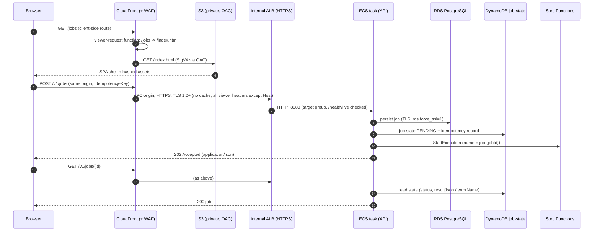
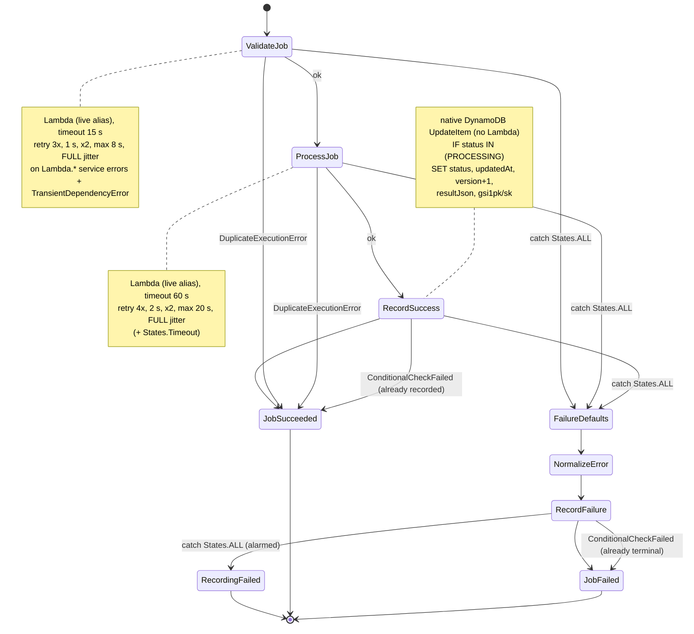
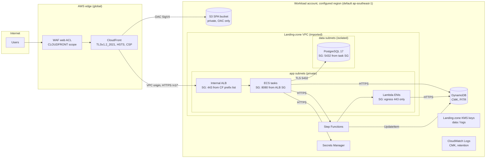
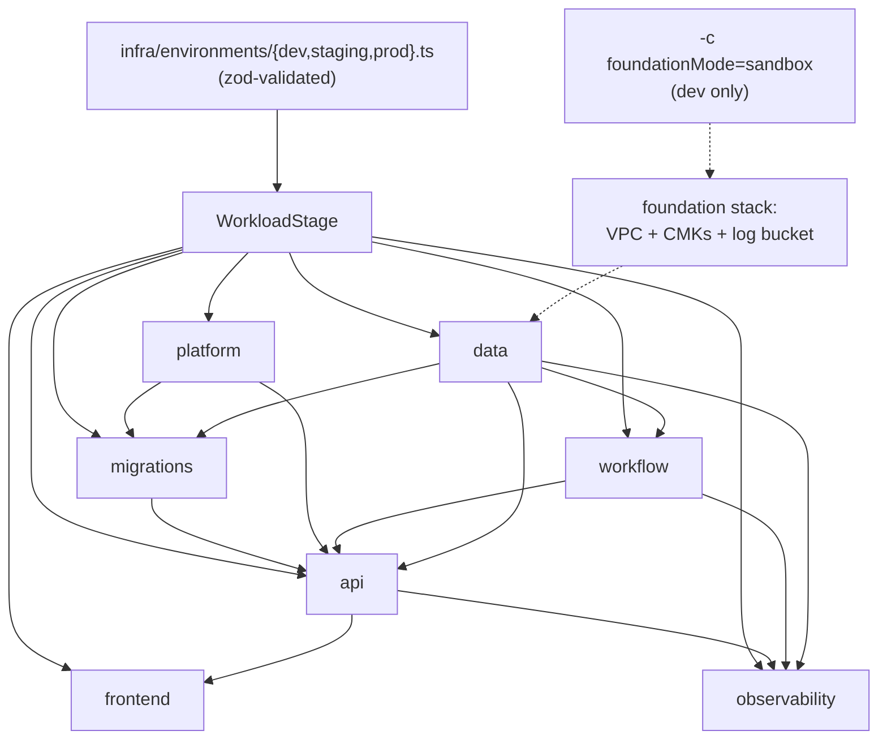
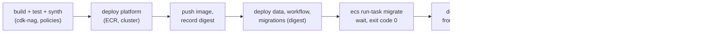

# Architecture

> **Status.** The `dev`, `staging` and `prod` stages described below are designed, synthesized
> offline (`cdk synth`, no AWS credentials) and covered by assertion tests and the policy checks;
> they have never been deployed. The reference was validated once, with the opt-in sandbox profile,
> in a disposable personal sandbox account; that is not proof of compliance with any landing zone
> ([limitations.md](limitations.md)). Account IDs and landing-zone IDs in `infra/environments/` are
> placeholders. See [landing-zone-adaptation.md](landing-zone-adaptation.md)
> for what has to be wired to a real landing-zone foundation, and what is assumed vs verified.

## 1. Overview

| Concern            | Component                                                       | Code                                                               |
| ------------------ | --------------------------------------------------------------- | ------------------------------------------------------------------ |
| Web UI             | React SPA in a private S3 bucket behind CloudFront (OAC)        | `apps/web`, `infra/constructs/spa-hosting.ts`                      |
| API                | Fastify on ECS Fargate (arm64) behind an **internal** ALB       | `apps/api`, `infra/constructs/api-service.ts`                      |
| Same-origin API    | CloudFront behaviour `/v1/*` → **VPC origin** → internal ALB    | `infra/constructs/spa-hosting.ts`                                  |
| Async processing   | Step Functions STANDARD + validator/processor Lambdas           | `workflows/processing`, `functions/*`                              |
| System of record   | RDS for PostgreSQL 17 (isolated subnets)                        | `infra/constructs/relational-database.ts`                          |
| Workflow state     | DynamoDB single table (job state, step audit, idempotency)      | `infra/constructs/job-state-table.ts`                              |
| Container platform | ECS cluster (Fargate/Spot) + ECR (immutable, scan on push, CMK) | `infra/stacks/platform-stack.ts`, `constructs/image-repository.ts` |
| DB migrations      | One-off Fargate task, same image: `node dist/migrate.js up`     | `infra/constructs/database-migration-task.ts`                      |
| Observability      | CloudWatch alarms + dashboard, SNS (CMK), X-Ray, JSON logs      | `infra/constructs/observability.ts`                                |
| FinOps             | AWS Budgets on cost-allocation tags; required tags everywhere   | `infra/constructs/cost-guardrails.ts`, `lib/tagging.ts`            |
| Landing zone       | Imported VPC/subnets, KMS keys, certs, DNS, WAF, boundary       | `infra/constructs/foundation/`                                     |
| Policy-as-code     | cdk-nag `AwsSolutions` (+ `@starter/policies` pack) at synth    | `infra/lib/policy-hook.ts`                                         |

## 2. Request flow

- SPA routing is a CloudFront **Function on the default behaviour only** — not
  global custom error responses — so a `404`/`403` from the API under `/v1/*` is
  returned to the client unchanged.
- The browser never talks to the ALB directly: the ALB is `internal`, its
  security group only admits the CloudFront origin-facing prefix list on 443,
  and it only has an HTTPS listener (`ELBSecurityPolicy-TLS13-1-2-2021-06`).

## 3. Processing workflow

Defined once in `workflows/processing/src/spec.ts` (state names, statuses,
timeouts, retry policy, error names, DynamoDB layout) and rendered to Amazon
States Language by `@starter/workflow-processing/cdk`. Since spec 2.0.0 (ADR 0230) the
execution input is only `{ jobId, contractVersion, submittedAt }`: the validator and processor load
the document from PostgreSQL through `load_job_document()` as `starter_processor`, the processor writes
its result onto the job-state item itself, and no task input, output or error cause carries document
content. A scheduled reconciler (ADR 0231) fails jobs that stay non-terminal after their execution
failed, timed out, was aborted or never started; it never touches a running execution. Tests assert the synthesized
`Retry`, `TimeoutSeconds` and `Catch` blocks equal the spec.

- Execution timeout: 600 s (spec). An execution-level timeout cannot be caught, so it
  must exceed the worst-case path through every task timeout and retry
  (`worstCaseExecutionSeconds()` = 491 s; asserted by `workflows/processing/test/spec.test.ts`).
  The record states have a 10 s task timeout so the budget is bounded.
- Failure path: every catch goes to `FailureDefaults` → `NormalizeError`, which merges the
  caught `$.error` over `{ Error: 'States.Unknown', Cause: 'No cause was reported…' }` with
  `States.JsonMerge` — Step Functions does not always report a `Cause`, and a missing JSONPath
  would raise an uncatchable `States.Runtime`. If `RecordFailure` itself fails (other than
  `ConditionalCheckFailed`), the execution ends in the explicit `RecordingFailed` Fail state
  (failed-executions alarm); the job item may then stay non-terminal until the stale-job
  reconciler fails it (ADR 0231).
- Encryption: the state machine (definition, execution history, inputs) uses the foundation
  **data** CMK; the API task role has
  `kms:GenerateDataKey` on it, scoped by the `aws:states:stateMachineArn` encryption context.
  Execution history is still retained by Step Functions for 90 days.
- Logging level `ALL` to a KMS-encrypted log group
  (`/aws/vendedlogs/states/<prefix>-job-processing`); execution payloads are logged only
  in dev (`workflow.logExecutionData`; staging and prod are rejected by config validation).
  X-Ray on.
- `RecordSuccess`/`RecordFailure` are the **same conditional transitions** as
  `DynamoDbJobStateStore.recordSuccess/recordFailure` in `@starter/job-state`:
  `SET status, updatedAt = $$.State.EnteredTime, version = version + 1, gsi1pk = STATUS#<status>, gsi1sk = <EnteredTime>#<jobId>`
  (+ `resultJson` from `$.processing.resultJson` and `REMOVE errorName, errorMessage`
  on success; `errorName = $.failure.error.Error`, `errorMessage = $.failure.error.Cause` on
  failure — the normalised error),
  conditional on `attribute_exists(pk) AND status IN (<legal predecessors>)` —
  `PROCESSING` for success, `PENDING/VALIDATING/PROCESSING` for failure (a test
  cross-checks these against `allowedPredecessors` in `@starter/domain`).
  A `DynamoDB.ConditionalCheckFailedException` means an earlier delivery already
  recorded the outcome: RecordSuccess then ends in `JobSucceeded`, RecordFailure
  in `JobFailed` with the original error. Transient DynamoDB errors are retried
  (`PROCESSING_WORKFLOW.recordStates` in the spec).
- Handler contract (see also [contracts.md](contracts.md) §4):
  - validator input: `ProcessingExecutionInput & { executionArn }`; output (`{jobId, valid, wordCount, byteLength, rulesVersion, duplicate}`) at `$.validation`;
  - processor input: `ProcessingExecutionInput & { executionArn, validation }`; output (`{jobId, result, resultJson, duplicate}`) at `$.processing`;
  - handlers record `VALIDATING`/`PROCESSING` themselves through conditional transitions, absorb duplicate deliveries (they never throw `DuplicateExecutionError`; the catcher remains for the spec's semantics) and throw errors whose `name` is a `WorkflowError` (or `JobStateConflictError`, which is not retried).
- Lambda environment: `JOBS_TABLE_NAME`, `LOG_LEVEL`, `APP_ENVIRONMENT`,
  `APP_VERSION` (when `-c appVersion` is given); never `DYNAMODB_ENDPOINT`. The
  bundle includes the lockfile-pinned AWS SDK v3 (no reliance on the runtime's copy).
- Lambda timeout = spec task timeout; versions are published on every change and
  the state machine invokes the `live` alias, never `$LATEST`.

## 4. Network and security boundaries

Security group chain (tested): `CloudFront prefix list → ALB:443 → tasks:8080 → PostgreSQL:5432`,
plus `migration task → PostgreSQL:5432`. No security group allows ingress from a CIDR. Task and Lambda egress is limited
to TCP 443 (AWS APIs via central egress or VPC endpoints); the database SG has no
egress.

| Control                        | Implementation                                                                                                                                                                                                                                                                                                                                                                                                                                                                                                                                                                                   |
| ------------------------------ | ------------------------------------------------------------------------------------------------------------------------------------------------------------------------------------------------------------------------------------------------------------------------------------------------------------------------------------------------------------------------------------------------------------------------------------------------------------------------------------------------------------------------------------------------------------------------------------------------ |
| Authentication / authorization | OIDC/JWT bearer tokens verified by the API against the issuer's JWKS (asymmetric algorithms, exact `iss`/`aud`, `iat`/`exp` with bounded skew, ID-token and foreign-client rejection; ADR 0210); jobs are owned by `owner_issuer` + `owner_subject` and every read/list/conflict lookup is filtered by owner in SQL (another owner's job = 404; ADR 0211); principal-scoped idempotency; per-principal and failed-auth per-IP rate limits (ADR 0212); one audit event per `/v1` request. No row-level security; not validated against an organization IdP ([limitations.md](limitations.md) §4). |
| Encryption at rest             | Foundation **data** CMK: RDS storage + Performance Insights, DB secret, DynamoDB, ECR, Step Functions (definition, history, inputs). **Logs** CMK: all log groups. Dedicated CMK for the alarm topic. SPA bucket SSE-S3 (static, public-by-nature assets).                                                                                                                                                                                                                                                                                                                                       |
| Encryption in transit          | CloudFront TLSv1.2_2021; CloudFront→ALB HTTPS (TLS 1.2); ALB TLS 1.3/1.2 policy; PostgreSQL `rds.force_ssl=1` with `DB_SSL=verify-full` against the vendored Amazon RDS CA bundle (chain and host name verified; ADR 0222); **ALB→task is plain HTTP on 8080 inside the VPC and carries bearer tokens**; S3 `aws:SecureTransport` + TLS ≥ 1.2; SNS `enforceSSL`.                                                                                                                                                                                                                                 |
| Identity                       | Least-privilege roles (explicit actions/ARNs, `kms:ViaService` conditions); no AWS-managed policies on app roles; landing-zone permissions boundary on **every** role (aspect); ECS exec disabled.                                                                                                                                                                                                                                                                                                                                                                                               |
| Container hardening            | arm64, distroless non-root `65532:65532`, read-only root FS (+ writable `/tmp` volume), not privileged, all Linux capabilities dropped, init process, image pinned by digest (API and migration task).                                                                                                                                                                                                                                                                                                                                                                                           |
| Audit/logging                  | CloudFront + ALB + S3 access logs to the foundation log bucket; ECS/Lambda/Step Functions/RDS logs in CMK-encrypted groups with explicit retention (enforced by an aspect); pgaudit (`ddl,role`).                                                                                                                                                                                                                                                                                                                                                                                                |
| Tagging                        | `Project, Environment, Owner, CostCentre, DataClassification, ManagedBy` on every taggable resource (aspect + synth-time verifier) plus landing-zone `mandatoryTags`.                                                                                                                                                                                                                                                                                                                                                                                                                            |
| Policy gates                   | cdk-nag `AwsSolutions` + `BaselineChecks` as CDK validation plugins: any unacknowledged **error** fails synth (warnings such as BASE-LMB-004 are reported, not blocking); acknowledgments are per resource + rule with a reason (see [policy-as-code.md](policy-as-code.md)).                                                                                                                                                                                                                                                                                                                    |

## 5. Environments

The same constructs and stacks are used in every environment; only validated
data differs. Each environment is one CDK **Stage** (`Dev`, `Staging`, `Prod`),
deployed into its own account (placeholder `000000000000`; override with
`-c account.<env>=…` or `STARTER_ACCOUNT_ID_<ENV>`).

| Setting                     | dev                                           | staging                        | prod                                                          |
| --------------------------- | --------------------------------------------- | ------------------------------ | ------------------------------------------------------------- |
| Foundation                  | import (sandbox opt-in)                       | import (enforced)              | import (enforced)                                             |
| API tasks (min/desired/max) | 1/1/2, 0.25 vCPU, Fargate Spot                | 2/2/4, 0.5 vCPU                | 3/3/9, 1 vCPU                                                 |
| RDS                         | t4g.micro, single-AZ, 1-day backups, SNAPSHOT | t4g.medium, 7 days, RETAIN, PI | m7g.large, **Multi-AZ**, 35 days, RETAIN, PI, 15 s monitoring |
| Deletion protection         | off                                           | RDS, DynamoDB, ALB             | RDS, DynamoDB, ALB                                            |
| DynamoDB                    | PITR 7 d, DESTROY                             | PITR 35 d, RETAIN              | PITR 35 d, RETAIN                                             |
| Log retention               | 30 d                                          | 90 d                           | 365 d (schema minimum)                                        |
| Step Functions payload logs | yes                                           | yes                            | **no** (schema-enforced)                                      |
| WAF                         | optional                                      | required                       | required                                                      |
| Monthly budget              | USD 150                                       | USD 400                        | USD 1 500                                                     |
| Termination protection      | off                                           | on                             | on                                                            |

Guard rails in the schema (synth fails with the offending path): staging/prod must
import the foundation and have a WAF, deletion protection and RETAIN on RDS and
DynamoDB, ≥ 7 days of backups and no Fargate Spot; prod additionally requires
Multi-AZ, ≥ 2 tasks, ≥ 365 days of logs and no payload logging. Certificates are
checked for region (CloudFront: us-east-1; ALB: stack region).

### Stacks and cross-stack references

| Stack (`<prefix>-…`) | Contents                                                                                                | Consumes                      |
| -------------------- | ------------------------------------------------------------------------------------------------------- | ----------------------------- |
| `platform`           | ECS cluster (Fargate + Spot providers, Container Insights); ECR repository when `api.ecr.mode = create` | foundation VPC, data key      |
| `data`               | RDS PostgreSQL, DB secret, job-state table                                                              | foundation VPC/subnets/keys   |
| `workflow`           | validator/processor Lambdas (+ versions, `live` aliases), state machine                                 | table (data)                  |
| `migrations`         | one-off DB migration task definition, its SG + DB ingress rule, log group                               | platform, data                |
| `api`                | ECS service/task, internal ALB, SG rules (incl. DB ingress); depends on `migrations`                    | platform, data, workflow      |
| `frontend`           | S3, CloudFront (OAC + VPC origin), response headers, function, DNS aliases                              | ALB ARN (api)                 |
| `observability`      | alarms, dashboard, SNS topic + CMK, budget                                                              | platform, api, workflow, data |

References between stacks are explicit construct props and render as classic
`Fn::ImportValue` exports (`@aws-cdk/core:defaultCrossStackReferences = strong`,
see ADR 0300). Foundation values are imported per stack (literal IDs), so they
never become exports.

## 6. Data design

| Store                    | Responsibility                                                                                                                                                                                                   | Why                                                                                                                             |
| ------------------------ | ---------------------------------------------------------------------------------------------------------------------------------------------------------------------------------------------------------------- | ------------------------------------------------------------------------------------------------------------------------------- |
| RDS PostgreSQL 17        | System of record for relational domain data (jobs as submitted, reference data, reporting queries); schema owned by versioned SQL migrations in `apps/api/migrations/`                                           | Relational integrity, ad-hoc queries, transactions, familiar operations for most teams                                          |
| DynamoDB job-state table | Workflow execution state (`JOB#<id>/STATE`), step audit trail (`STEP#<ts>#<state>`), idempotency records (`IDEMPOTENCY#<key>`, TTL `expiresAt`), status index `gsi1` (`STATUS#<status>` / `<updatedAt>#<jobId>`) | Written natively by Step Functions (no Lambda), conditional writes for idempotency, TTL, predictable latency, on-demand billing |

- The DynamoDB layout is defined in the spec and shared by Step Functions, the
  handlers and the API. `version` is a monotonic counter incremented by every
  state write (`SET version = version + 1`) for optimistic concurrency; every
  status write is conditional on a legal predecessor status.
- IAM follows the SDK calls the code actually makes: handlers get
  `GetItem/PutItem/UpdateItem` on `JOB#` items only (`dynamodb:LeadingKeys`); the reconciler
  `Query` on `gsi1` plus `GetItem/UpdateItem` on `JOB#` items; the API `GetItem/BatchGetItem/PutItem/UpdateItem`
  (no index access until it queries `gsi1`); the state machine `UpdateItem`;
  each with the data CMK limited to `kms:ViaService = dynamodb.<region>`.
- PostgreSQL identities (ADRs 0220/0221): `starter_owner` owns every object; `starter_migrator`
  migrates through `SET ROLE starter_owner`; the API runs as `starter_app` (INSERT + column SELECT without
  `content`); the Lambdas run as `starter_processor`, which may only call the `SECURITY DEFINER` function
  `load_job_document(uuid)` (one row, created within the last hour); `starter_retention` serves the
  disabled-by-default purge. On AWS every login role uses **RDS IAM authentication** (a token per new
  connection, `rds-db:connect` scoped per database user); no task or Lambda receives a password or the
  master secret. The master secret is read at runtime only by the one-off bootstrap task (governed
  exception EXC-0005) and rotates in every environment.

## 7. Deployment and rollback

Deployment order follows stack dependencies. The **image must be pushed to
the registry before** anything references its digest, and **migrations run
before** the API rolls out (the `api` stack depends on `migrations`):

| Component      | Deploy                                                                                                                                                                                                                                                                                                                                     | Rollback                                                                                                                                                                                                                                                                   |
| -------------- | ------------------------------------------------------------------------------------------------------------------------------------------------------------------------------------------------------------------------------------------------------------------------------------------------------------------------------------------ | -------------------------------------------------------------------------------------------------------------------------------------------------------------------------------------------------------------------------------------------------------------------------- |
| ECS API        | Immutable image **digest** in the task definition (`-c apiImageDigest=sha256:…`, `requireImageDigest=true` in deploy jobs). Rolling 100 %/200 %, ALB and container health on `/health/live` (ECS replaces tasks failing the ALB check, so it must not depend on RDS/DynamoDB), 60 s grace; `/health/ready` gates post-deploy smoke checks. | **ECS deployment circuit breaker with automatic rollback** to the last steady task definition; CloudFormation rolls back the stack on failure. Manual: redeploy the previous digest (the registry keeps 100 images). Post-deploy smoke failure → redeploy previous digest. |
| Lambda         | Every code/config change publishes a new version (`currentVersion`); the `live` alias is repointed in the same deployment; old versions are **retained**.                                                                                                                                                                                  | Repoint `live` to the previous version (`aws lambda update-alias`) or redeploy the previous commit. Canary shifting (CodeDeploy) is a documented extension.                                                                                                                |
| Step Functions | Definition updated in place; running STANDARD executions finish on the definition they started with; execution names are deterministic per job (`job-<id>`).                                                                                                                                                                               | Redeploy the previous definition (it references the `live` aliases).                                                                                                                                                                                                       |
| RDS PostgreSQL | Versioned, forward-only SQL migrations run by the `migrations` task (`node dist/migrate.js up`, same image digest) before the new API version, using **expand → migrate → contract** so old and new API versions both work during rollout. Minor engine upgrades in the maintenance window.                                                | **No automated database rollback.** Roll forward with a corrective migration. Disaster recovery: point-in-time restore / snapshot to a new instance (RETAIN + deletion protection prevent accidental loss).                                                                |
| DynamoDB       | Schemaless; changes are additive attributes or new GSIs.                                                                                                                                                                                                                                                                                   | PITR (35 days in staging/prod) restore into a new table.                                                                                                                                                                                                                   |
| SPA            | Upload hashed assets first, then `index.html`; invalidate `/index.html`.                                                                                                                                                                                                                                                                   | Re-sync the previous build (bucket versioning keeps 30 days of noncurrent objects).                                                                                                                                                                                        |
| Infrastructure | CloudFormation change sets per stack, termination protection in staging/prod, RETAIN on stateful resources.                                                                                                                                                                                                                                | CloudFormation automatic rollback; stateful resources are never deleted by a stack rollback.                                                                                                                                                                               |

## 8. Observability

Alarms (SNS topic encrypted with a dedicated CMK; email subscriptions from config):
ALB 5xx, target 5xx, unhealthy targets, ECS CPU and memory, Lambda errors and
throttles (per function), Step Functions failed and timed-out executions, RDS CPU
and free storage. A per-environment dashboard shows the same signals plus API
latency (p90) and request count. Lambda and Step Functions use X-Ray; ECS has
Container Insights (enhanced).

## 9. Integration mini-stack

`IntegrationWorkflowStack` (`infra/stacks/integration-workflow-stack.ts`,
`infra/bin/integration.ts`) deploys the **same** `JobStateTable` and `ProcessingWorkflow`
constructs, isolated per CI run (`starter-it-<runId>`), fully destroyable, with an ephemeral CMK and
sweeper tags (`starter:ephemeral`, `starter:run-id`, `starter:expires-at`). It is what the AWS integration
tests run against. Its emulator variant (`-c target=emulator`, no state machine version/alias) is
deployed to the MiniStack emulator by `tests/aws-integration/emulator/ci.sh` — in GitLab CI as a
socket-less service — and is synthesized only in an environment the shared emulator guard
(`infra/lib/emulator-guard.ts`) accepts (ADR 0602). Emulator runs are not AWS evidence.
