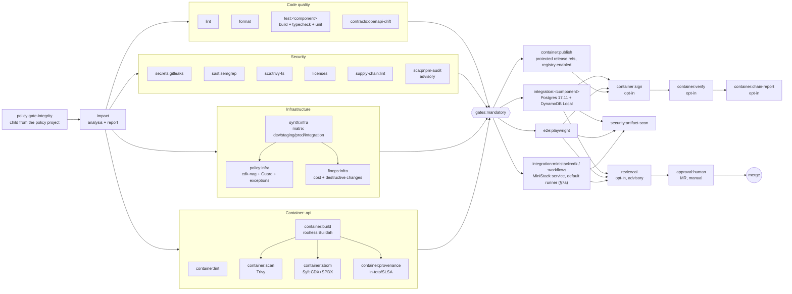

# CI/CD pipeline (GitLab)

Source of truth: `.gitlab-ci.yml`,
`.gitlab/ci/*.yml`, `components.yaml`, `tools/impact`, `tools/ci`; the optional gate-integrity policy lives in
a Maintainer-only policy project (`<group>/ci-policy`). Security model: [security.md](security.md).
Running it on your own GitLab: [§11 Bring your own GitLab](#11-bring-your-own-gitlab).
Design records: ADR [0401](adr/0401-ci-impact-analysis-generated-rules.md),
[0402](adr/0402-rootless-buildah-container-builds.md),
[0403](adr/0403-mandatory-gate-and-truthful-reporting.md),
[0404](adr/0404-advisory-ai-review-pr-agent.md),
[0410](adr/0410-gate-integrity-maintainer-only-policy-project.md) (gate integrity),
[0411](adr/0411-protected-release-chain-sign-and-verify.md) (release chain, sign, verify),
[0412](adr/0412-scheduled-pipelines.md) (schedules); runners: [0110](adr/0110-protected-runners-and-network-isolation.md),
secrets: [0111](adr/0111-runner-scoped-secrets-and-key-custody.md).

## 1. Shape of a pipeline

Everything is wired with `needs` (a DAG); stages only order the UI. With **zero configuration** every
job runs on one generic Docker-executor runner that accepts untagged jobs (no privileged mode, no
container socket, no runner-mounted files; §11). Runner tags are optional variables (ADR 0110), all
empty by default — GitLab drops an empty tag, so the job is untagged:

| Variable                       | Jobs                                                                                                            |
| ------------------------------ | --------------------------------------------------------------------------------------------------------------- |
| `STARTER_RUNNER_TAG`           | every ordinary job (`default: tags`), explicitly the MiniStack jobs and `security:protected-secrets`            |
| `STARTER_RELEASE_RUNNER_TAG`   | the image build chain: `container:{build,scan,sbom,provenance}:<id>`                                            |
| `STARTER_PROTECTED_RUNNER_TAG` | jobs that only exist on protected refs: `container:{publish,verify,chain-report}:<id>`, schedule tasks, `aws:*` |
| `STARTER_SIGNER_RUNNER_TAG`    | `container:sign:<id>` (the runner that mounts the signing key; release signing only)                            |

Set `STARTER_RELEASE_RUNNER_TAG` as a **protected** project variable to build releases on a protected
runner while MR builds stay untagged. MR pipelines build, scan and describe an **unsigned** image and
never publish, sign or verify.



| Stage         | Jobs                                                                                                                                                                                                                                                                                                                                                                                                       |
| ------------- | ---------------------------------------------------------------------------------------------------------------------------------------------------------------------------------------------------------------------------------------------------------------------------------------------------------------------------------------------------------------------------------------------------------- |
| `.pre`        | `policy:gate-integrity` (only when the project's CI config is the gate policy, §4a)                                                                                                                                                                                                                                                                                                                        |
| `impact`      | `impact`                                                                                                                                                                                                                                                                                                                                                                                                   |
| `verify`      | `lint`, `format`, `test:<component>` (generated), `contracts:openapi-drift`, `secrets:gitleaks`, `sast:semgrep`, `sca:trivy-fs`, `sca:pnpm-audit`, `licenses`, `supply-chain:lint`, `security:protected-secrets`, `container:lint:<id>`, `synth:<infra>` (matrix), `policy:<infra>`, `finops:<infra>`; schedule tasks `container:rescan-verify:<id>`, `container:rescan:<id>`, `scheduled:stale-resources` |
| `package`     | `container:build:<id>`, `container:scan:<id>`, `container:sbom:<id>`, `container:provenance:<id>`                                                                                                                                                                                                                                                                                                          |
| `gate`        | `gates:mandatory`, `release:status`, `container:publish:<id>`, `container:sign:<id>`, `container:verify:<id>`, `container:chain-report:<id>`                                                                                                                                                                                                                                                               |
| `integration` | `integration:<component>` (generated), `e2e:playwright`, `integration:ministack:cdk`, `integration:ministack:workflows` (§7a)                                                                                                                                                                                                                                                                              |
| `review`      | `review:ai` / `review:ai-status` (both only when `AI_REVIEW_ENABLED=true`)                                                                                                                                                                                                                                                                                                                                 |
| `approval`    | `approval:human` (MR pipelines, blocking manual job)                                                                                                                                                                                                                                                                                                                                                       |
| `aws`         | `aws:status`, `aws:cdk-diff`, `aws:integration:{deploy,test,cleanup}`, `aws:drift`, `aws:sweeper`                                                                                                                                                                                                                                                                                                          |

### Pipeline types (`workflow:rules`)

| Trigger                                  | Pipeline                                                                                        | Component jobs                                        |
| ---------------------------------------- | ----------------------------------------------------------------------------------------------- | ----------------------------------------------------- |
| MR event                                 | merge request pipeline                                                                          | impact-selected (`rules:changes` vs. the MR diff)     |
| push to a branch **with** an open MR     | none (no duplicate branch pipeline)                                                             | —                                                     |
| push to a branch without MR              | branch pipeline                                                                                 | impact-selected (vs. previous push; new branch → all) |
| default branch, tag, web/API trigger     | full pipeline; publish (+ opt-in signing) if the ref is protected                               | **all**                                               |
| schedule without `SCHEDULE_TASK`         | full nightly pipeline                                                                           | **all**                                               |
| schedule `SCHEDULE_TASK=rescan`          | `container:rescan-verify:<id>` → `container:rescan:<id>` (protected ref; needs release signing) | none                                                  |
| schedule `SCHEDULE_TASK=stale`           | `scheduled:stale-resources` (protected ref)                                                     | none                                                  |
| schedule `SCHEDULE_TASK=drift` / `sweep` | `aws:drift` / `aws:sweeper` when `AWS_JOBS_ENABLED=true`, else only `aws:status`                | none                                                  |

Schedules are pipeline schedules on a protected ref that set `SCHEDULE_TASK` (ADR 0412). Task names are
matched explicitly (`rescan|stale|drift|sweep`); an unknown task name gets the full pipeline.

`IMPACT_RUN_ALL=true` forces everything:

- **MR:** MR pipelines accept no run-time variables, and no branch pipeline is created while an MR
  is open. A Maintainer sets `IMPACT_RUN_ALL=true` as a **temporary project CI/CD variable**,
  starts a new MR pipeline and deletes the variable. Alternatively, the MR includes a change to a
  global path (`components.yaml` `global:`); when gate integrity is enabled (optional), that is a
  gate-defining change and needs gate approval (§4a).
- **Branch without an open MR:** a Maintainer enters it in the Run pipeline form (only Maintainers
  may set pipeline variables: `restrict_user_defined_variables`).

`impact` and `gates:mandatory` print the same advice when the analysis and the pipeline disagree.

## 2. Impact analysis

`tools/impact` (package `@starter/tool-impact`, runs from source on Node 24) reads the
pnpm workspace graph (every `package.json`, `workspace:` dependencies) plus
`components.yaml`, and decides which components — and therefore which jobs — a
change affects.

- **Base**: `CI_MERGE_REQUEST_DIFF_BASE_SHA` (MR) → `CI_COMMIT_BEFORE_SHA` (push) →
  explicit `--base`. A missing base commit in the shallow clone is fetched.
- **Selection**: files → owning components (package dir + `extraPaths`) → reverse
  dependency closure over `package.json` edges and explicit `dependsOn` edges
  (e.g. `infra` bundles the Lambdas at synth time).
- **Fail-safe**: global paths (root configs, lockfile, `components.yaml`, CI files,
  `tools/impact`, `tools/ci`) → run everything; zero/missing base or any git error →
  run everything; default branch, tags, schedules → run everything; **a changed path
  that `components.yaml` does not map fails the pipeline** (nothing is ever silently
  skipped).
- **Report**: `reports/impact/impact.{json,md}` (exposed in the MR as "Impact report")
  lists every component/job with the reason (e.g. `depends on contracts: api -> contracts`),
  plus `impact.env` (dotenv: `IMPACT_MODE`, `IMPACT_COMPONENTS`, …).

### Why generated `rules:changes` (and not a dynamic child pipeline)

GitLab evaluates `rules` when the pipeline is created, so a job cannot prune
later jobs. We generate `.gitlab/ci/generated/components.yml` from
`components.yaml`: one `.impact:<component>` rules template per component whose
`changes:paths` are the component's own paths **plus the paths of every
transitive workspace dependency plus the global paths**. Matching any of them is
exactly "component is in the reverse dependency closure of a changed path" — a
unit test simulates GitLab's matcher (Ruby `fnmatch`, implemented in
`tools/impact/src/glob.ts`) and asserts both agree for every fixture.

- One parent pipeline keeps JUnit, coverage, Code Quality, SBOM and dotenv
  reports visible in the MR widget (child-pipeline reports are not aggregated there).
- The `impact` job **fails if the generated file is stale** (e.g. someone added a
  `workspace:` dependency without regenerating), and `gates:mandatory` re-checks the
  runtime analysis against the jobs that actually ran (§4).
- Trade-off: rules are static; the runtime analyser is the cross-check. See ADR 0401.

### Fixture-tested scenarios (`tools/impact/test`)

frontend-only, backend-only (incl. container chain), shared contracts (fan-out to
api/web/functions/infra), CDK infra (synth/policy/finops, no app jobs), policy-only,
root config (run all), CI config (run all), unknown path (fails), missing base
(run all), docs-only (repo-wide jobs only), default branch/tags/schedules/override
(run all), rename (both owners), stale generated file (fails), gate markers
(missing job, partial matrix, name-prefix confusion).

## 3. Job catalogue

| Job                              | Image (pinned in `.gitlab/ci/images.yml`) | Gate  | Notes / reports                                                                                                                                                                             |
| -------------------------------- | ----------------------------------------- | ----- | ------------------------------------------------------------------------------------------------------------------------------------------------------------------------------------------- |
| `impact`                         | node 24                                   | (pre) | validates `components.yaml`, staleness, unmapped paths; warms the pnpm store cache                                                                                                          |
| `lint`                           | node 24                                   | yes   | root `pnpm lint` (ESLint, max-warnings 0) → Code Quality report                                                                                                                             |
| `format`                         | node 24                                   | yes   | root `pnpm format:check`                                                                                                                                                                    |
| `test:<component>`               | node 24                                   | yes   | deps build → build → typecheck → `test:unit` with JUnit + Cobertura (`coverage` regex)                                                                                                      |
| `contracts:openapi-drift`        | node 24                                   | yes   | regenerate `packages/contracts/openapi`, fail on diff (also covered by a contracts unit test)                                                                                               |
| `secrets:gitleaks`               | gitleaks 8.30.1                           | yes   | MR commits / pushed range / full history; JUnit                                                                                                                                             |
| `sast:semgrep`                   | GitLab SAST semgrep 6.26.1                | yes   | rules pinned by image digest; fails on Critical/High unless suppressed inline (`nosemgrep: <rule id> -- <reason>`) or by a waiver in `.gitlab/security/sast-exceptions.json` (none shipped) |
| `sca:trivy-fs`                   | trivy 0.74.0                              | yes   | `pnpm-lock.yaml` incl. dev deps; fails on fixable HIGH/CRITICAL; JUnit + full JSON                                                                                                          |
| `sca:pnpm-audit`                 | node 24                                   | no    | second opinion (npm advisory DB), `allow_failure`                                                                                                                                           |
| `licenses`                       | node 24                                   | yes   | `pnpm licenses list -r` vs `.gitlab/security/license-policy.yaml`; JUnit                                                                                                                    |
| `supply-chain:lint`              | node 24                                   | yes   | image + Dockerfile digest pinning, exception expiry (≤ 90 days), no whole-file SAST waivers, image release-age exceptions (§7a)                                                             |
| `security:protected-secrets`     | node 24                                   | yes   | default runner, every pipeline: fails on any `COSIGN_*`/`AWS_*` (except region, `AWS_JOBS_ENABLED`)/`STARTER_SIGNING_*` variable name or runner-scoped mount (names only)                   |
| `container:lint:<id>`            | hadolint 2.15.1                           | yes   | `.hadolint.yaml`; Code Quality                                                                                                                                                              |
| `container:build:<id>`           | buildah 1.43.4                            | via ↓ | rootless, non-privileged; OCI archive + digest + dotenv `<ID>_IMAGE_DIGEST`; fresh clone; a runner that blocks user namespaces fails with a diagnosis (§11)                                 |
| `container:scan:<id>`            | trivy 0.74.0                              | yes   | vulnerabilities + secrets in the image; ignore file with expiry                                                                                                                             |
| `container:sbom:<id>`            | syft 1.52.0                               | yes   | CycloneDX + SPDX JSON (`reports:cyclonedx`)                                                                                                                                                 |
| `container:provenance:<id>`      | node 24                                   | yes   | in-toto v1 / SLSA v1 statement; attested by `container:sign` when signing is enabled, else NOT SIGNED                                                                                       |
| `synth:<infra>` (matrix)         | node 24                                   | yes   | offline `cdk synth` per environment (cdk-nag v3 validation inside synth)                                                                                                                    |
| `policy:<infra>`                 | node 24                                   | yes   | cfn-guard 3.2.1 (SHA-256 verified) over all assemblies + governed exception audit; JUnit                                                                                                    |
| `finops:<infra>`                 | node 24                                   | yes   | cost delta + destructive changes vs. base synthesized in a worktree; MR label `finops-approved` to accept                                                                                   |
| `gates:mandatory`                | node 24                                   | —     | §4                                                                                                                                                                                          |
| `release:status`                 | node 24                                   | no    | every full pipeline: image build on/opted out, publication, "signing: not configured"; fails only on an incomplete signing opt-in (§11)                                                     |
| `integration:<component>`        | node 24 + services                        | after | PostgreSQL 17.11 + DynamoDB Local 3.3.1 as `services:`                                                                                                                                      |
| `e2e:playwright`                 | playwright 1.63.0                         | after | API + `vite preview` + Chromium                                                                                                                                                             |
| `integration:ministack:<suite>`  | node 24 + MiniStack 1.5.26 service        | after | `cdk` (mini-stack deploy, reconcile, destroy) and `workflows` against the emulator; §7a                                                                                                     |
| `container:publish:<id>`         | skopeo 1.22.3                             | after | protected release refs with the project registry enabled; `:<sha>` + moving tag, digest-preserving; TLS verified unless `REGISTRY_TLS_VERIFY=false`                                         |
| `container:sign:<id>`            | cosign 3.1.3                              | after | opt-in (`STARTER_RELEASE_SIGNING=true`), `STARTER_SIGNER_RUNNER_TAG`; signs the published digest, attests SLSA provenance + CycloneDX with the runner-mounted key; **fails** without a key  |
| `container:verify:<id>`          | cosign 3.1.3                              | after | opt-in with signing, protected runner; runner-mounted trust anchor = committed `.gitlab/security/cosign.pub`; signature, tag → digest, both attestations, two negative controls             |
| `container:chain-report:<id>`    | node 24                                   | after | opt-in with signing; every chain job ran on a configured protected/signer runner tag from a fresh clone (no tag configured = FAIL)                                                          |
| `container:rescan-verify:<id>`   | cosign 3.1.3                              | sched | `SCHEDULE_TASK=rescan`: the moving tag must carry a valid signature + SBOM attestation (needs signing; fails with "signing: not configured" otherwise)                                      |
| `container:rescan:<id>`          | trivy 0.74.0                              | sched | today's DB over the signed image and its attested SBOM; fixable HIGH/CRITICAL fail                                                                                                          |
| `scheduled:stale-resources`      | node 24                                   | sched | `SCHEDULE_TASK=stale`: report-only list of stale branches, MRs, artifacts, registry tags; exit 79 = findings (warning)                                                                      |
| `policy:gate-integrity`          | (bridge)                                  | pre   | child pipeline from the policy project; blocks changed gate-defining paths without Maintainer approval (§4a)                                                                                |
| `review:ai` / `review:ai-status` | PR-Agent 0.46.0 / node                    | no    | opt-in (`AI_REVIEW_ENABLED=true`); absent otherwise; advisory; see security.md                                                                                                              |
| `approval:human`                 | node 24                                   | MR    | blocking manual job, approver ≠ head-commit author (audit trail; see security.md §8 for CE limits)                                                                                          |
| `aws:*`                          | node 24                                   | no    | opt-in, protected refs, `STARTER_PROTECTED_RUNNER_TAG`; §7; `aws:status` always reports                                                                                                     |

Optional capabilities that are **not configured** have no check jobs at all, so nothing pretends to
have run; a status job says so in plain words and is green (ADR 0403): `aws:status` ("aws: not
configured — not executed"), `release:status` ("signing: not configured — published images are
UNSIGNED"). A capability that is opted in but incomplete is a **warning** (exit 78, allowed:
`review:ai-status`, `aws:drift` exit 3) or, where it must not be mistaken for a pass, a **failure**:
`release:status` with signing enabled but its runners or registry missing; `container:sign`/`verify`
without a key or trust anchor. The `STARTER_CONTAINER_BUILD=false` opt-out is always a warning.

## 4. Mandatory gate

`gates:mandatory` `needs` every gate-relevant job with `optional: true`, so it
only starts when all present gated jobs passed. Each gated job (template
`.gated`) leaves a dotenv marker `GATE_<job id>=<job name>` in `after_script` on
success; the gate inherits the markers and runs `tools/impact gate`, which fails
when a job the runtime impact analysis requires is missing, when a matrix is
incomplete, or when the analysis itself reported errors. Integration tests, image
publication, AI review and approval all start after the gate.

The gate checks the pipeline the MR defined. An MR that edits the definition (deletes a job, makes a
check `allow_failure`, drops a component) changes what "required" means, which is why §4a exists.

## 4a. Gate integrity (ADR 0410)

Optional. With the gate policy installed, the project's CI/CD configuration file is
`projects/<slug>/gate-policy.yml@<group>/ci-policy` (Maintainer-only project; setup in §11). It includes the
project's `.gitlab-ci.yml` from the pipeline's commit and adds `policy:gate-integrity`, a bridge
whose child pipeline comes only from that policy project. The child job hashes the gate-defining paths
(listed in security.md §7) and fails unless the state equals the default branch's reference state or
a state a Maintainer approved for this MR. `impact` needs the bridge, so a blocked check stops the
whole pipeline, and "pipelines must succeed" blocks the merge.

Changing a gate-defining file in an MR therefore takes three steps:

1. The pipeline fails at `gate:integrity`, which lists the changed entries.
2. A Maintainer reviews the change and approves its gate state outside the MR
   (`tools/ci/scripts/gate-admin.sh approve --project <path> --policy-project <group>/ci-policy --mr <iid> --rerun`;
   implementation `tools/ci/src/gate-admin.ts`, the GitLab API driver of `node tools/ci/src/cli.ts gate-policy`).
3. After the merge, the Maintainer re-pins the reference (`gate-admin.sh sync --project <path> --policy-project …`).

**Changing the list of gate-defining paths** (`DEFAULT_GATE_PATHS` in `tools/ci/src/gate-policy.ts`,
e.g. the emulator layer) is itself a `tools/ci` change, so it
follows the three steps above. It does **not** take effect by merging: the live policy
(`projects/<slug>/policy.json` in the policy project) keeps its own `paths`, and `sync`/`install`
re-pin the reference over those. After the merge, after reviewing the merged gate-path diff, a
Maintainer adopts the new list:

```bash
tools/ci/scripts/gate-admin.sh sync --project <path> --policy-project <group>/ci-policy \
  --adopt-default-paths --expect-head <reviewed main sha>
```

- The list is read from `tools/ci/src/gate-policy.ts` **as committed at the default-branch head**
  being synced (`state --paths-from-rev`, `sync --adopt-default-paths --git-dir`), never from the
  operator's working tree: a dirty or other-branch checkout cannot change it.
- `--expect-head` is **required**: adoption is refused without it and if `main` moved past the
  reviewed commit; the output lists the tree entry of every newly protected path. Removing a path
  needs `--allow-path-removal`.
- The reference is re-pinned over the new list and every approval is dropped (their ids hash the
  old list). `sync`, `approve` and `check` refuse a state computed over another path list.

Until the adoption runs, the new paths are **not** protected; afterwards `gate-admin.sh status`
shows the new reference id, and an MR touching e.g. `tests/aws-integration/emulator/ci.sh`
fails at `gate:integrity`.

## 5. Caches, artifacts, reports

- pnpm store cache keyed on `pnpm-lock.yaml` (`pnpm-store-v1-…`): `impact` pulls and
  pushes, every other Node job only pulls. Corepack's pnpm download goes to `/tmp`
  (outside the project dir so linters never see it).
- Trivy downloads its DB per job (seconds); the 1.6 GB unpacked DB is not cached.
- Artifacts expire (1 week for test output, 2–4 weeks for security evidence, 3 days
  for OCI archives). Reports: `junit`, `coverage_report` (Cobertura), `codequality`,
  `sast`, `cyclonedx`, `dotenv`; `expose_as` for the impact, gate and FinOps reports.
- `interruptible: true` by default (new commits auto-cancel), except deploy/cleanup,
  publish and approval jobs.

## 6. Adding a component (service, Lambda, library)

1. Create the workspace package (`apps/…`, `functions/…`, `packages/…`) with the
   standard scripts `build`, `typecheck`, `test:unit` (vitest).
2. Add **one** entry to `components.yaml` (`id`, `kind`, `path`, `package`; for
   deployables `deploy` with stack/strategy/health checks/rollback; for a
   container also `build.artifact` with `type: container-image`, `dockerfile`, `image`).
3. `pnpm --filter @starter/tool-impact run generate` (the pre-commit hook does this) and
   commit `components.yaml` + `.gitlab/ci/generated/components.yml`.

That's all: `test:<id>`, rules with transitive dependencies, gate wiring, and — for
containers — the full lint/build/scan/SBOM/provenance/sign/publish chain are
generated. A new Lambda bundled by CDK also gets `dependsOn` from `infra` (or a
`workspace:` dependency) so infra checks re-run when it changes. The test
`adding a component needs only a manifest entry` demonstrates this end to end.

## 7. AWS-dependent jobs

Opt-in. Created **only** on protected refs with the non-secret project variable
`AWS_JOBS_ENABLED=true`, and run on the runner selected by `STARTER_PROTECTED_RUNNER_TAG`. The jobs:

- `aws:cdk-diff` (real diff, informational);
- `aws:integration:deploy` (manual; needs a green `policy:infra`) → `aws:integration:test` →
  `aws:integration:cleanup`
  (`when: always`, idempotent);
- scheduled `aws:drift` (`SCHEDULE_TASK=drift`) and `aws:sweeper` (`SCHEDULE_TASK=sweep`, a dry run
  unless `SWEEP_APPLY=true`).

Credentials are **not** CI/CD variables (ADR 0111). They are files a dedicated protected runner
mounts at `/run/starter-aws/` (`AWS_SHARED_CREDENTIALS_FILE`, `AWS_CONFIG_FILE`); a job fails if they
are missing. Without the switch, `aws:status` writes `reports/status/aws.{md,json}` ("not configured —
not executed" for each job) and is green: it is a report, not a passed AWS check. MR pipelines never
get AWS jobs.

Schedules: pipeline schedules with `SCHEDULE_TASK` (ADR 0412; table in §1).

## 7a. Emulator integration jobs (MiniStack)

`.gitlab/ci/emulator.yml` adds two hand-written jobs that run the AWS integration mini-stack
against **MiniStack**, an AWS emulator, started as a GitLab service. They are an emulator layer,
not AWS evidence: what they prove and what they cannot prove is described in
[ministack.md](ministack.md).

| Job                               | Runs                                                                                 |
| --------------------------------- | ------------------------------------------------------------------------------------ |
| `integration:ministack:cdk`       | `bash tests/aws-integration/emulator/ci.sh cdk`: deploy, reconcile, destroy          |
| `integration:ministack:workflows` | `bash tests/aws-integration/emulator/ci.sh workflows`: the processing workflow suite |

- **DAG.** Both `need` `impact` and `gates:mandatory` (stage `integration`), so they start only
  after every required check passed. Both are optional `needs` of `security:artifact-scan`, which
  leak-scans their artifacts. Like every `integration:*` job they are not gated jobs themselves:
  with no `allow_failure`, a failure fails the pipeline, and "pipelines must succeed" blocks the
  merge.
- **Selection.** They extend `.impact:tests-aws-integration`, so they run when `infra`,
  `workflows/processing`, the Lambdas, the shared packages, `policies`, `tests/aws-integration` or
  a global path changes, and on every default-branch, tag and full scheduled pipeline. A docs-only
  MR starts neither. `tools/impact` reads the include like every hand-written file
  (`tools/impact/test/emulator-selection.test.ts` checks the analyser and the GitLab rule agree).
- **Serialisation.** `resource_group: ci-ministack`: a safety net for runners that put every job on
  one user-defined network (`network_mode`), where the service alias `ministack` would be visible to
  concurrent jobs; a stock Docker executor scopes the alias to the job. Two MiniStack jobs never run
  at the same time, across pipelines. Timeout 20 minutes.
- **Artifacts.** `when: always`, 2 weeks: `reports/aws-integration/emulator/` (one directory per
  run, including `egress.jsonl`/`egress.json`), JUnit
  `reports/aws-integration/emulator/*/report/junit.xml`. `CI_DEBUG_SERVICES=true` puts the
  MiniStack service log in the job log (masked like any job log).
- **Gate-defining (only with the optional gate integrity, once adopted, §4a).** The guard, `tests/aws-integration/emulator/` (scripts,
  egress audit, not-applicable baseline), `tests/aws-integration/src/emulator-{ci,gaps,reconcile,results}.ts`
  and what decides which emulator tests run and how the guard resolves (`live-harness.ts`,
  `aws-gate.ts`, the suite's `package.json`/`tsconfig.build.json`/`vitest.config.ts`,
  `infra/bin/integration.ts`, `infra/package.json`, `infra/tsconfig.json`) are in
  `DEFAULT_GATE_PATHS`. They are protected only after a Maintainer adopted the list on the live
  policy (§4a); from then on weakening them needs Maintainer gate approval.
- **Image.** `IMG_MINISTACK` in `images.yml`: `ministackorg/ministack:1.5.26` by OCI index digest
  (linux/amd64 + linux/arm64). A pin younger than the 14-day image rule needs a release-age exception
  in `.gitlab/security/image-age-exceptions.yaml`. `supply-chain:lint` fails if the entry does not
  name the exact pin, lacks a release date, reason or approver, or expires more than 14 days after
  the release; an exception is consulted only while the pinned release is younger than 14 days; an entry that expires while the release is still younger is an error, and once the release is 14 days old the entry is reported as a warning to delete it — nothing fails merely because time passed.

**Trust boundary.** MiniStack is an untrusted third-party process; it sees only synthetic data,
fake credentials and the synthesized templates and bundles.

- **Runner.** `tags: ['$STARTER_RUNNER_TAG']` explicitly: the default runner (a generic Docker
  executor: no container socket, no privileged mode, no runner-scoped mounts; the service image is
  digest-pinned). The jobs never use `.protected-runner` or the release/protected/signer tags, so they
  never reach a runner that holds AWS credentials or a signing key. `security:protected-secrets`, a
  gated job of the same pipeline on the same runner, proves no `AWS_*`/`COSIGN_*` CI/CD variable and
  no runner-scoped mount reaches default-runner jobs.
- **No socket, no nesting.** `LAMBDA_EXECUTOR=local`: Lambdas run inside the service. No
  Docker-in-Docker, no `DOCKER_HOST`, no Podman socket, no extra capabilities.
- **Fake credentials.** `AWS_ACCESS_KEY_ID=000000000001`,
  `AWS_SECRET_ACCESS_KEY=ministack-local-only`, `AWS_CONFIG_FILE=/dev/null`,
  `AWS_SHARED_CREDENTIALS_FILE=/dev/null`, IMDS disabled,
  `AWS_ENDPOINT_URL=http://ministack:4566`. GitLab Runner passes a service only the job's public
  variables (never masked or protected variables, never `CI_JOB_TOKEN`). The service overrides
  `AWS_ENDPOINT_URL` with its own loopback (`http://127.0.0.1:4566`), because MiniStack's local
  Lambda workers inherit the service environment and must call MiniStack, not the job's alias.
- **Loopback forwarder.** The CDK CLI addresses S3 asset buckets virtual-host style
  (`<bucket>.ministack`), which no DNS resolves. After the guard accepts the job environment,
  `ci.sh` starts a forwarder on `127.0.0.1` whose only upstream is the allowlisted endpoint; every
  `cdk` and SDK child process runs in loopback mode against it and passes the guard again.
- **Fail closed.** `STARTER_EMULATOR_MODE=ci-service` and `STARTER_EMULATOR_ALLOWED_ENDPOINT` make the
  endpoint guard of `ci.sh` accept exactly `http://ministack:4566`; anything that could reach real
  AWS (a profile, a session token, a service-specific endpoint, another endpoint, a proxy, a CDK
  `TELEMETRY_ENDPOINT`) makes it refuse before any `cdk` or SDK call. The job labels the refusal in
  the log and exits with the guard's code, so a refusal is a visible failure, never a skip.
- **No CDK CLI phone-home.** CDK CLI 2.1144 can contact, besides the AWS
  endpoint, its telemetry endpoint (`cdk-cli-telemetry.us-east-1.api.aws`, through a detached sender
  process), the notices feed (`cli.cdk.dev-tools.aws.dev`) and the npm registry (version check),
  each optionally through a proxy. A bootstrap run from an empty directory without
  `infra/cdk.json` would send telemetry, so every `cdk` call (bootstrap, synth, deploy, destroy) runs
  with `CDK_DISABLE_CLI_TELEMETRY=true` and `CDK_DISABLE_VERSION_CHECK=true` (job variables, set
  again by `ci.sh`, required by the guard), `--no-notices --context cli-telemetry=false` on the
  command line, a bootstrap `cdk.json` with the same switches, an empty private `HOME` (no
  `~/.cdk.json` proxy, plugin or context), every proxy variable removed and `CDK_DOCKER` pointing
  at a refusing stub (bundling stays local).
- **Egress audit.** After the guard, `ci.sh` preloads `tests/aws-integration/emulator/egress-audit.mjs`
  into every Node process it starts (`NODE_OPTIONS=--import=…`: the CDK CLI and its children, the
  CDK app, the emulator CLIs, the vitest workers). It allows connections only to the
  guard-validated endpoint (the forwarder alone to `ministack:4566`, everything else only to the
  forwarder), blocks and records every other connection, DNS query (including `lookupService`) and
  UDP send, refuses a caller-supplied `lookup` for an allowed host name, and records detached child
  processes and worker threads as violations (both would escape the audit). Every child process,
  async or sync, is recorded and gets the audit back into its environment even if its caller passed
  a clean `env`. The final `egress audit` step fails the job on any violation or if `cdk` was never
  audited (`egress.json`). Not covered: non-Node executables (esbuild, the pnpm executable, `sh`,
  `curl`, …: recorded as `uncovered`, not intercepted), Node processes started by such an
  executable with a cleared environment (`env -i node …`), and the MiniStack service container's
  own traffic. `src/emulator-egress.test.ts` reproduces the leak with the
  pre-fix command (a loopback sink receives the TLS ClientHello) and requires zero violations from
  the fixed commands.
- **Residual risks.** On a runner whose jobs share one network, another concurrent job could
  register the alias `ministack` (integrity of the results, not confidentiality: there is nothing
  secret to steal). The service has no memory cap of its own (a runner's `memory` limit applies to
  the job container only). The image's network egress is not restricted, and the job's dependency install
  (`before_script`) uses the registry/cache like every Node job, before the emulator steps.

`tools/ci/test/emulator-jobs.test.ts` pins these properties of the committed YAML.

**On a generic GitLab Runner.** Docker executor, services allowed (the default), **no** privileged
mode and no socket mount. If the runner restricts services (`allowed_services`), admit the pinned
`IMG_MINISTACK` digest; it must be pullable from `docker.io`. Budget host memory for MiniStack on top
of the job container (a runner's `memory` setting does not apply to services). Nothing else is
required: no tag, no CI/CD variables, no AWS account.

## 8. Negative tests: how blocking is demonstrated

Each gate has a failing fixture or a reproducible MR:

| Gate                  | Demonstration                                                                                                                                                                                                                                                                                                                                                                          |
| --------------------- | -------------------------------------------------------------------------------------------------------------------------------------------------------------------------------------------------------------------------------------------------------------------------------------------------------------------------------------------------------------------------------------- |
| unmapped path         | MR adding `random/x.txt` → `impact` fails ("not mapped to any component"); unit test `unknown path fails loudly`                                                                                                                                                                                                                                                                       |
| stale generated rules | add a `workspace:` dep without `generate` → `impact` fails; unit test                                                                                                                                                                                                                                                                                                                  |
| gate cross-check      | unit tests in `tools/impact/test/manifest-gate.test.ts` (missing job, partial matrix, prefix collision)                                                                                                                                                                                                                                                                                |
| secrets               | commit a fake `glpat-…`/AWS key → `secrets:gitleaks` + pre-commit hook fail                                                                                                                                                                                                                                                                                                            |
| unpinned image / FROM | `image: node:24` or `FROM node:24` → `supply-chain:lint` fails; unit tests                                                                                                                                                                                                                                                                                                             |
| exception hygiene     | exception without justification / > 90 days → `supply-chain:lint` fails; unit tests                                                                                                                                                                                                                                                                                                    |
| image release age     | an age exception that names another pin, lacks release date/approver, outlives release + 14 days, or has expired while the release is still younger than 14 days → `supply-chain:lint` fails (an aged release only warns); `tools/ci/test/supply-chain.test.ts`                                                                                                                        |
| emulator guard        | a profile, session token, service-specific or other endpoint, proxy or CDK telemetry endpoint → `ci.sh` refuses before any AWS call and `integration:ministack:*` fails (labelled in the log); trust-boundary YAML pinned by `tools/ci/test/emulator-jobs.test.ts`                                                                                                                     |
| emulator egress       | a connection or DNS query through Node's `net`/`dns`/`dgram`/`http(s)` APIs to anything but the emulator → blocked, `egress audit` fails; `tests/aws-integration/src/emulator-egress.test.ts` (pre-fix bootstrap reproduces the telemetry ClientHello; fixed commands: zero violations). Not covered: non-Node executables, raw internal bindings, the service container (ADR 0602 §7) |
| licenses              | GPL/unknown license → `licenses` fails; unit tests                                                                                                                                                                                                                                                                                                                                     |
| SAST                  | a bare `nosemgrep` or one without exactly one rule id and a reason fails `tools/ci/test/sast-gate.test.ts`; a register waiver stops applying at its expiry or when the flagged code changes → `sast:semgrep` blocks again                                                                                                                                                              |
| container             | root `USER` → `container:build` fails; hadolint `DL*` warnings fail `container:lint`                                                                                                                                                                                                                                                                                                   |
| FinOps                | new NAT/RDS/ALB without `finops-approved` → `finops:infra` exits 1                                                                                                                                                                                                                                                                                                                     |
| policies              | the Guard and cdk-nag pass/fail fixtures (`policies/test`), `REQUIRE_CFN_GUARD=1`                                                                                                                                                                                                                                                                                                      |
| gate integrity        | MRs by a Developer: gitleaks `allow_failure`, deleted gate job, gate script `exit 0`, dropped component, self-approved exception, added/replaced `cosign.pub`, bridge override — each blocked by `gate:integrity` (ADR 0410); unit tests run the rendered check; `gate-admin sync --adopt-default-paths` without `--expect-head` is refused (`tools/ci/test/gate-admin.test.ts`)       |
| signing / verify      | opt-in path: `container:verify` rejects an unsigned artifact and an unrelated key in every run; a re-tagged unsigned image fails verification; `release:status` fails when signing is enabled without its runners or registry (`tools/ci/test/reports.test.ts`)                                                                                                                        |
| signing not enabled   | no sign/verify job exists; `release:status` and the provenance status say "signing: not configured" / NOT SIGNED; the rescan fails instead of trusting an unsigned image (`tools/ci/test/ci-portability.test.ts`)                                                                                                                                                                      |
| runner portability    | a literal or undefined runner tag, a bespoke runner name, `network_mode`/`extra_hosts`, a socket or `privileged` in CI YAML, or a registry script bypassing the TLS policy fails `tools/ci/test/ci-portability.test.ts`                                                                                                                                                                |
| secrets binding       | `security:protected-secrets` fails on a `COSIGN_*`/`AWS_*`/`STARTER_SIGNING_*` name or a runner-scoped mount; unit tests                                                                                                                                                                                                                                                               |
| SAST waivers          | a waiver whose code fingerprint no longer matches stops applying; whole-file waivers fail `supply-chain:lint`; `tools/ci/test/sast-gate.test.ts`                                                                                                                                                                                                                                       |
| gitleaks allowlist    | any allowlist without description and rule/match scope fails `tools/ci/test/gitleaks-config.test.ts`                                                                                                                                                                                                                                                                                   |
| schedule rules        | a bare `$SCHEDULE_TASK` condition fails `tools/impact/test/schedule-rules.test.ts`                                                                                                                                                                                                                                                                                                     |

## 9. Local equivalents

`lefthook.yml` (hooks installed by `pnpm install` through `scripts/git-hooks/install.sh`; skip with
`LEFTHOOK=0`, remove with `sh scripts/git-hooks/install.sh --uninstall`): pre-commit runs prettier + ESLint on
staged files, gitleaks on staged changes, hadolint on changed Dockerfiles,
regenerates the CI rules when manifests change, and `vitest related` for staged
TS files. pre-push runs typecheck + unit tests for packages affected since
`origin/main` (via `tools/impact plan`) and offline synth + Guard when infra or
policies are affected. Tools fall back to the pinned CI images on rootless Podman
(macOS or Linux: `eval "$(scripts/podman/rootless-socket.sh env)"`)
and print `SKIP` if neither a binary nor an engine is available — CI enforces anyway.

Useful commands:

```sh
node tools/impact/src/cli.ts analyze --base origin/main   # what would CI run?
node tools/impact/src/cli.ts plan --base origin/main      # pnpm filters for affected packages
pnpm --filter @starter/tool-impact run generate               # regenerate CI rules
node tools/ci/src/cli.ts supply-chain-lint --out reports/supply-chain
```

## 10. CI/CD variables

None is required: see the table in §11. Secrets are never CI/CD variables except the optional
`AI_REVIEW_GITLAB_TOKEN`/`AI_REVIEW_API_KEY` of the advisory AI review (masked, not protected, so
readable by code that runs in MR pipelines; see [security.md](security.md) §10). Signing keys and
AWS credentials are runner-mounted files (ADR 0111); `security:protected-secrets` fails if any appear
as variables in a default-runner job.

## 11. Bring your own GitLab

The pipeline needs **one generic runner and zero project configuration**; everything else is an
explicit opt-in. It is verified on a self-managed GitLab CE with one generic Docker-executor runner
(no tags, not privileged, no mounts). GitLab.com hosted runners are expected to work but are
untested; in particular, whether rootless Buildah works there depends on the runner's container
engine (see "Runners that cannot run rootless Buildah" below).

### Minimal runner

- Docker executor, `privileged = false`, no extra `volumes`, no `network_mode`, no container socket;
  services allowed (the default); amd64 or arm64 (every pinned image is multi-arch).
- **Run untagged jobs** enabled (or set `STARTER_RUNNER_TAG` and friends to its tag, below).
- Memory: the MiniStack and E2E jobs run services next to the job container; give the host at least
  4 GB per concurrent job. Concurrency 1–2 is plenty for one project.
- Network: jobs pull pinned images (docker.io, quay.io, gcr.io, mcr.microsoft.com,
  registry.gitlab.com) and packages from the npm registry; Trivy downloads its vulnerability DB.
- Image pulls: every job pulls digest-pinned images, so a busy runner can hit anonymous registry
  rate limits (Docker Hub). Because a digest cannot change content, it is safe to set
  `pull_policy = ["always", "if-not-present"]` in the runner's `[runners.docker]` section (pull
  first, fall back to the local copy), or to log the runner in / use a registry mirror.
- Job containers must reach GitLab at the URL they clone from. If GitLab's external URL is not
  reachable from containers (a self-managed instance on `localhost`, or a runner on Podman), set the
  runner's `clone_url` (and a reachable `url`) in `config.toml`; with rootless Podman on macOS,
  `http://host.containers.internal:<port>` reaches a port published on the host.

Register it (GitLab 16+ runner authentication tokens). In the project: **Settings → CI/CD → Runners →
New project runner**, tick _Run untagged jobs_, leave tags empty, create, and store the shown token in a
file only you can read. On the runner host:

```sh
# The token is read from a file into the environment (never typed on the command line).
CI_SERVER_TOKEN="$(cat ~/.config/gitlab-runner/project-runner-token)" \
  gitlab-runner register --non-interactive \
    --url "https://gitlab.example.com" \
    --executor docker \
    --docker-image "$(awk '$1 == "IMG_NODE:" {print $2}' .gitlab/ci/images.yml)" \
    --docker-privileged=false
```

The default image is only the runner's fallback; any small image works, because every job names its
own digest-pinned image (the example reuses the pinned Node.js image). GitLab.com hosted Linux runners
accept untagged jobs, so no registration is needed there, but they are untested with this pipeline.

Project settings (recommended, not required): _Merge requests → Pipelines must succeed_; keep the
default branch protected (release jobs exist only on protected refs).

### What runs with zero configuration

| Pipeline       | Runs                                                                                                                                                                                                                                                                                                                                                                                                                  | Absent                                                                                   |
| -------------- | --------------------------------------------------------------------------------------------------------------------------------------------------------------------------------------------------------------------------------------------------------------------------------------------------------------------------------------------------------------------------------------------------------------------- | ---------------------------------------------------------------------------------------- |
| merge request  | `impact`; every gate (lint, format, tests, OpenAPI drift, gitleaks, Semgrep, Trivy fs, licenses, supply-chain lint, protected-secrets, synth/policy/finops, container lint/build/scan/SBOM/provenance, image config) as selected by impact; `gates:mandatory`; integration and E2E jobs; `integration:ministack:{cdk,workflows}`; `security:artifact-scan`; `release:status`; `aws:status`; `approval:human` (manual) | `review:ai*`, publish, sign, verify, chain report, `aws:*` jobs, `policy:gate-integrity` |
| default branch | everything (run-all) plus `container:publish:<id>` when the project registry is enabled; `release:status` says "signing: not configured — published images are UNSIGNED"; `aws:status` says "aws: not configured — not executed"                                                                                                                                                                                      | sign, verify, chain report, `review:ai*`, AWS jobs                                       |

`approval:human` is a blocking manual job at the end of every MR pipeline: a person other than the
head-commit author plays it (an audit record, not a CE-enforced control; security.md §8). A project
that does not want it sets `REQUIRE_HUMAN_APPROVAL=false`.

### Variables (all optional)

| Variable                                                                                                  | Default        | Effect                                                                                                                                                                                           |
| --------------------------------------------------------------------------------------------------------- | -------------- | ------------------------------------------------------------------------------------------------------------------------------------------------------------------------------------------------ |
| `STARTER_RUNNER_TAG`                                                                                      | empty          | runner tag of ordinary jobs; empty = untagged                                                                                                                                                    |
| `STARTER_RELEASE_RUNNER_TAG`                                                                              | empty          | runner tag of `container:{build,scan,sbom,provenance}`; as a **protected** variable only protected-ref builds move (MR builds stay untagged)                                                     |
| `STARTER_PROTECTED_RUNNER_TAG`                                                                            | empty          | runner tag of protected-ref-only jobs (publish, verify, chain report, schedule tasks, `aws:*`)                                                                                                   |
| `STARTER_SIGNER_RUNNER_TAG`                                                                               | empty          | runner tag of `container:sign` (the runner that mounts the key)                                                                                                                                  |
| `STARTER_RELEASE_SIGNING`                                                                                 | `false`        | `true` creates sign, verify and chain report on protected release refs; `release:status` fails if their prerequisites are missing                                                                |
| `STARTER_CONTAINER_BUILD`                                                                                 | `true`         | `false` opts out of build/scan/SBOM/provenance/publish/sign (runners that cannot run rootless Buildah); reported as a warning by `release:status` and as a notice by the gate                    |
| `REGISTRY_TLS_VERIFY`                                                                                     | `true`         | `false` allows plain HTTP / an unverified certificate for the project registry (lab only); any other value fails                                                                                 |
| `REQUIRE_HUMAN_APPROVAL`                                                                                  | `true`         | `false` removes `approval:human`                                                                                                                                                                 |
| `AI_REVIEW_ENABLED`                                                                                       | `false`        | `true` + `AI_REVIEW_GITLAB_TOKEN` (masked), `AI_REVIEW_API_BASE`, `AI_REVIEW_MODEL`, optional `AI_REVIEW_API_KEY` (masked) creates `review:ai`; enabled but incomplete: `review:ai-status` warns |
| `AWS_JOBS_ENABLED`                                                                                        | unset          | `true` creates the AWS jobs on protected refs (credentials mounted on the protected runner); `STARTER_ACCOUNT_ID_<ENV>` (not secrets) for the AWS jobs                                           |
| `IMPACT_RUN_ALL`                                                                                          | `false`        | `true` runs every job (§1)                                                                                                                                                                       |
| `SCHEDULE_TASK`, `SWEEP_APPLY`                                                                            | empty, `false` | on a pipeline schedule: `rescan`, `stale`, `drift` or `sweep` (ADR 0412); `SWEEP_APPLY=true` deletes                                                                                             |
| `STARTER_EXCEPTION_APPROVALS` (File)                                                                      | unset          | Maintainer-approved exception digests for `policy:<infra>`; written by `gate-admin exceptions`                                                                                                   |
| predefined `CI_REGISTRY`, `CI_REGISTRY_IMAGE`, `CI_REGISTRY_USER`, `CI_REGISTRY_PASSWORD`, `CI_JOB_TOKEN` | (GitLab)       | the project registry and the job's own token; nothing to configure                                                                                                                               |

### Release signing (opt-in)

Signing keys are **files mounted by dedicated runners, never CI/CD variables** (ADR 0111): a
protected variable reaches every job of a protected-ref pipeline on every runner, including the one
that runs ordinary jobs, and `security:protected-secrets` fails if a `COSIGN_*` or
`STARTER_SIGNING_*` name reaches it. Signing therefore needs a self-managed runner for the signer
role (hosted runners cannot mount files).

1. Generate a key pair offline with the pinned cosign image (the password comes from a CSPRNG and
   reaches the container through the environment, not the command line):

   ```sh
   IMG_COSIGN=$(awk '$1 == "IMG_COSIGN:" {print $2}' .gitlab/ci/images.yml)
   umask 077 && mkdir -p ~/starter-signing && cd ~/starter-signing
   openssl rand -base64 48 | tr -d '\n' > cosign.password
   COSIGN_PASSWORD="$(cat cosign.password)" docker run --rm --network none \
     -e COSIGN_PASSWORD -v "$PWD:/keys" -w /keys --entrypoint cosign "$IMG_COSIGN" generate-key-pair
   ls  # cosign.key (encrypted), cosign.pub, cosign.password
   ```

2. Signer runner (tag e.g. `release-signer`; _Protected_, locked to the project, not running untagged
   jobs): mount the directory read-only, e.g. `volumes = ["/srv/starter-signing:/run/starter-signing:ro"]`
   with `cosign.key`, `cosign.password`, `cosign.pub` (directory 0700, files 0600). Restrict it to the
   cosign image (`allowed_images`) and no services if your runner version supports it.
3. Protected runner (tag e.g. `release-protected`; _Protected_): mount only the public key,
   `volumes = ["/srv/starter-trust:/run/starter-trust:ro"]` with `cosign.pub`. It runs publish,
   verify, the chain report and the image build chain of protected refs. Never mount either directory
   on the default runner.
4. Commit the public key as `.gitlab/security/cosign.pub` (`container:verify` fails if it differs
   from the trust anchor; with gate integrity this is a gate-defining change).
5. Project CI/CD variables (not secrets): `STARTER_RELEASE_SIGNING=true`,
   `STARTER_SIGNER_RUNNER_TAG=release-signer`, `STARTER_PROTECTED_RUNNER_TAG=release-protected`, and
   `STARTER_RELEASE_RUNNER_TAG=release-protected` flagged **Protected**.
6. Run the default-branch pipeline: `release:status` says "signing: configured", then
   `container:sign` → `container:verify` (signature, attestations, an unsigned artifact and an
   unrelated key are both rejected) → `container:chain-report`.

Rotation and revocation: ADR 0111. Without a transparency log (`--tlog-upload=false`) consumers trust
exactly the public key they pin.

### Gate integrity (opt-in)

1. Create a Maintainer-only project, e.g. `<group>/ci-policy` (default branch `main`; Developers of
   the application project get no access).
2. As a Maintainer of both projects, with a personal or project access token (`api` scope) in a file
   of mode 0600:

   ```sh
   export GITLAB_URL=https://gitlab.example.com
   export GITLAB_TOKEN_FILE=~/.config/gitlab/maintainer-token
   tools/ci/scripts/gate-admin.sh install --project <group>/<app> \
     --policy-project <group>/ci-policy --set-ci-config-path   # [--runner-tag <your STARTER_RUNNER_TAG>]
   ```

3. Day to day: `approve --mr <iid> --rerun`, `sync` after a merge, `sync --adopt-default-paths
--expect-head <reviewed sha>` after a merged change of `DEFAULT_GATE_PATHS`, `status`,
   `exceptions --file <approvals.yaml>` (§4a). The token is never printed or passed on a command line;
   plain `http://` is accepted only for a loopback address or with `GATE_ADMIN_ALLOW_HTTP=true`.

### AI review (opt-in)

Set `AI_REVIEW_ENABLED=true`, `AI_REVIEW_API_BASE` (an OpenAI-compatible endpoint, e.g. a LiteLLM
proxy), `AI_REVIEW_MODEL`, `AI_REVIEW_GITLAB_TOKEN` (project access token, Reporter, `api`, masked)
and optionally `AI_REVIEW_API_KEY` (masked). Advisory only (ADR 0404). Both secrets are ordinary
(unprotected) project variables, readable by any job of a merge-request pipeline whose YAML or
scripts the MR can change: use a dedicated, low-privilege token and a spend-limited endpoint key, and
enable it only where everyone with push access may hold both values. MRs from forks never run
`review:ai` ([security.md](security.md) §10).

### AWS jobs (opt-in)

A protected runner (`STARTER_PROTECTED_RUNNER_TAG`) that mounts `/run/starter-aws/{credentials,config}`
read-only, plus `AWS_JOBS_ENABLED=true` (§7). Nothing creates AWS resources without a manual job.

### Lab registry over plain HTTP (opt-in)

`REGISTRY_TLS_VERIFY=false` makes publish, sign, verify and the rescan accept plain HTTP or an
unverified certificate for the project registry. The default verifies TLS; a failed login prints this
hint.

### Runners that cannot run rootless Buildah

`container:build:<id>` builds rootless and unprivileged (Buildah, chroot isolation, vfs; ADR 0402). On
some Docker Engine hosts the default seccomp/AppArmor profile blocks the user namespaces and mounts
that `RUN` steps need; the job then fails with a diagnosis naming the evidence. Options:

1. Run the image build chain on a runner whose engine allows it, e.g. a Docker executor backed by
   rootless Podman, selected with `STARTER_RELEASE_RUNNER_TAG`. Relaxing seccomp/AppArmor on a Docker
   host also works but widens the kernel attack surface for every job on that runner; never enable
   privileged mode or mount a socket for it.
2. Opt out: `STARTER_CONTAINER_BUILD=false`. No image is built, scanned, described or published;
   `container:lint` still runs; `release:status` ends as a warning and `gates:mandatory` prints the
   opt-out. Scanning is never skipped for an image that was built.
